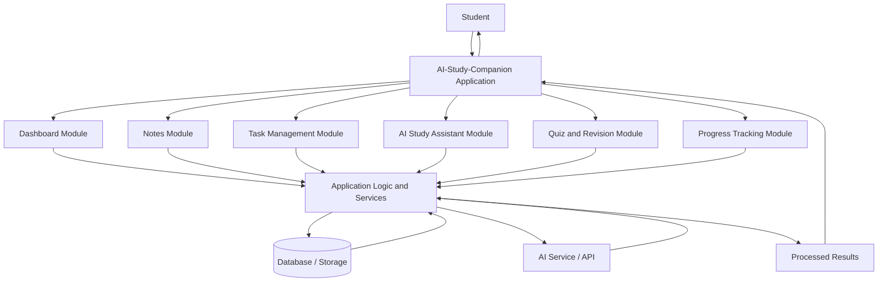

# AI-Study-Companion – System Architecture

## 1. Architecture Overview

AI-Study-Companion is organized into separate modules. The student interacts with the application through its interface. Each module handles a specific study-related functionality. Application services process requests and communicate with storage or an AI service when needed.

## 2. Architecture Diagram

## 3. Component Description

- **Student:** Uses the application for study activities.
- **Application:** Main interface for accessing features.
- **Dashboard Module:** Displays an overview of study activities.
- **Notes Module:** Creates and manages study notes.
- **Task Management Module:** Manages study tasks and deadlines.
- **AI Study Assistant Module:** Provides AI-based learning assistance.
- **Quiz and Revision Module:** Supports quizzes and revision activities.
- **Progress Tracking Module:** Tracks completed activities and progress.
- **Application Logic and Services:** Processes requests and coordinates modules.
- **Database / Storage:** Stores and retrieves application data.
- **AI Service / API:** Handles AI-related requests when integrated.
- **Processed Results:** Returns the processed information to the application.

## 4. System Workflow

1. The student opens the application.
2. The student selects a feature.
3. The selected module receives the request.
4. Application services process the request.
5. Data is stored or retrieved, or an AI service is called when required.
6. The processed result is returned to the application.
7. The application displays the result to the student.
